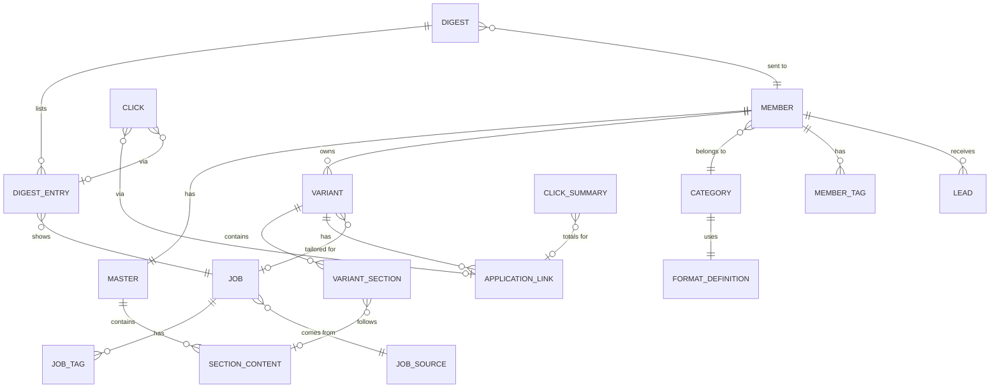

# Sheetfolio: Database Design and Data Model

> Status: **DRAFT for approval**, 11 Oct 2026
> Authority: `docs/architecture.md` (ADR-1 to ADR-4), `docs/requirements.md`, `docs/user-journeys.md`.
> This is a **conceptual** model: entities, fields in plain words, rules, retention and access. It contains **no SQL, no migrations and no final column types or indexes**. Those are implementation choices made after the managed SQL product is chosen (O-32). Where a rule here constrains them, it says so.

Labels: **CONFIRMED**, **ASSUMED**, **OPEN**, **PROPOSED**, **NEW**.

---

## 1. Modelling decisions taken this round

| Decision | Choice | Status |
| --- | --- | --- |
| Presentation | Entity tables plus a relationship diagram | CONFIRMED |
| Variant content | **Per section: follow the master (stores no copy) or frozen (stores its own copy)** | CONFIRMED |
| Account retention (O-13) | Delete on request within 30 days; click summaries kept | CONFIRMED |
| Deletion style | Soft delete for 30 days, then purge | CONFIRMED |
| Datastore | SQL primary, Redis for limits and cache (ADR-1, approved) | CONFIRMED |

Implications worth stating: "delete on request within 30 days" and "soft delete 30 days then purge" fit together. A deleted item is hidden at once, recoverable by the member for 30 days, then purged by a scheduled job. An **account deletion request** hides the account at once and purges within 30 days, with no recovery after the purge. Anonymous weekly totals are not personal data because they hold no member identity beyond the member's own deleted account (see §8, to be confirmed in the privacy review).

---

## 2. Relationship overview

Notes: a Click belongs to **either** an application link (visit to a page) **or** a digest entry (job click), never both. The two arrows are alternatives, expressed by the click's type.

---

## 3. Core entities

Fields are in plain words. "Required" means the application must always provide it. **All entities carry created time and last-changed time; entities that can be hidden carry a deleted time.** These are not repeated in every table.

### 3.1 Member and account

#### MEMBER
| Field | Notes |
| --- | --- |
| Identifier | Opaque, never the email |
| Email (verified) | Unique; the key for linking sign-in methods (ADR-2). Lower-cased for comparison. |
| Display name | Required for the page |
| Role | member or admin (admin is a role, ADR-2) |
| Category | One of the 10 (BR-1, FR-2.1). Required before setup is complete |
| Slug | Public address of the main page; unique; cannot shadow app routes (FR-2.8) |
| Time zone | IANA name; browser-detected then confirmed (O-14). May be empty until confirmed; empty means digest held and flagged |
| Plan | Value from a fixed set: `validation_free` for MVP members; later trial, starter, pro, lapsed (BR-6, BR-11). Stored now so phase 4 needs no reshaping |
| Status | active, suspended (J9), deletion requested |
| Digest preference | on, paused until a date, unsubscribed |
| Invited by / invitation state | For the invitation-only validation period (O-16) |
| Sign-in methods linked | Which methods the person has used (email link, Google). Not tokens |
| Deletion requested time | Starts the 30-day purge clock |

Rules: one member per verified email. A Google account is accepted only with a Google-verified email (ADR-2). Category change allowed with a warning (O-25); hidden sections are kept, not deleted.

#### MEMBER_TAG
| Field | Notes |
| --- | --- |
| Member, tag value, tag kind | Kinds: role, seniority, skill, location, work mode. Vocabulary and limits OPEN (O-4); stored as normalised values so a controlled list or free text can both be supported |

#### INVITATION
| Field | Notes |
| --- | --- |
| Email, invited by, state (sent, accepted, revoked, expired), expiry time | One open invitation per email |

Auth sessions, sign-in tokens and provider account links belong to the sign-in library's own tables and are **out of scope** for this model, apart from the rule that they link to MEMBER by verified email.

### 3.2 Categories and formats

#### CATEGORY
Fixed list of 10 (CONFIRMED). Fields: identifier, name, order in the build sequence, whether its format is available yet (drives the generic fallback, O-17).

#### FORMAT_DEFINITION
Configuration, not member content (ADR-3). Fields: category, ordered list of section slots (section type, label, required or optional, limits), confidentiality reminders, image rules, layout variant, sample content reference. Versioned, so a published page can be re-rendered consistently after a definition change. Whether definitions live in the database or in the codebase is an implementation choice; **PROPOSED: in the codebase, version-controlled, with a version number stored on pages** (simpler to test, fits a solo builder).

### 3.3 Master record and sections

#### MASTER
One per member (BR-1). Fields: member, format version used, draft state (draft only or has a published version), published time, last published snapshot reference. The master has a **draft** and a **published** version (existing behaviour, FR-2.7).

#### SECTION_CONTENT
The master's content, keyed by **section id**, so changing format keeps content (ADR-3).
| Field | Notes |
| --- | --- |
| Master, section id, section type | Section ids are stable names such as header, summary, items |
| Content | Structured data validated against that section type's rules |
| Order and visibility | Whether shown, and position |
| Draft or published version | Each section has both |

### 3.4 Variants

#### VARIANT
| Field | Notes |
| --- | --- |
| Member | Owner (BR-2) |
| Title | Member's name for it; defaults to job title and company |
| Job | Optional link to the job it was tailored for (J6). Keeps a **saved copy** of title, company and link so it survives the job being removed |
| Origin | blank, from master, from digest (Tailor my page), later: AI draft (ADR-8) |
| Slug or address | If variants have public addresses; **the application link is the public entry** (BR-3). Whether a variant also has its own address is OPEN (O-33) |
| State | draft, published, deleted-soft |
| Created / published time | The creation time is what counts for the north-star (O-20 PROPOSED) |

#### VARIANT_SECTION
One row per section a variant has.
| Field | Notes |
| --- | --- |
| Variant, section id | |
| Mode | **follow** or **frozen** (BR-10) |
| Frozen content | Present only when mode is frozen. A followed section stores **no copy** and reads the master (CONFIRMED) |
| Order and visibility | Own to the variant, even for followed sections |
| Draft or published version | As master |

Rules:
- Switching follow to frozen copies the master's current content at that moment into the frozen content. Switching frozen to follow **discards** the frozen copy only after the member confirms (the UI warns).
- Default mode for new variants and new sections when the master gains one: OPEN (O-5). PROPOSED: follow.
- Publishing a variant takes a **published snapshot** of its resolved content, so a later master edit changes a published variant only if the member publishes again. This protects what employers see (P8). OPEN to confirm (O-34).

### 3.5 Application links

#### APPLICATION_LINK
| Field | Notes |
| --- | --- |
| Code | Short, unguessable, unique; used in `/s/{code}` |
| Variant | The page it opens (BR-3) |
| Label | Member-chosen, 1 to 60 characters (ASSUMED) |
| State | active, retired, deleted-soft |
Rules: a variant may have many links. A **variant with links cannot be deleted** (O-18 PROPOSED); the member moves links to another variant first. A retired link shows the unavailable page.

### 3.6 Jobs, sources, digests

#### JOB_SOURCE
Name, address, **terms checked on (date) and by whom**, status (usable, blocked) (FR-3.7). A job from a source not checked cannot enter a digest.

#### JOB
| Field | Notes |
| --- | --- |
| Title, company, location, work mode, seniority | Required tags per FR-3.1 |
| Closing date, posted date | Jobs older than 14 days are rejected (BR-8) |
| Employer link | Destination of the tracked job link; **stored data, never taken from a URL** (ADR-4) |
| Summary | Short; not a copy of the full ad unless the source terms allow |
| Source | Required |
| Category(ies) | Which member categories it suits |
| State | collected, tagged, ready, expired, removed |

#### JOB_TAG
Job, tag value, tag kind. Matching uses overlap between job tags and member tags (FR-3.1).

#### DIGEST
One per member per week (idempotency key: member + week, ADR-5).
| Field | Notes |
| --- | --- |
| Member, week, scheduled send time, actual send time | Scheduled time is derived from the member's time zone |
| State | planned, queued, sent, failed, held |
| Failure reason | For the admin Failures screen (A9) |
| Recipients' time zone at send | Stored, since the member may change it later |

#### DIGEST_ENTRY
Digest, job, position (best match first), **why it matched** (the text shown), the job's saved title and company at send time. Allows reporting on exactly what was sent even if the job later changes.

### 3.7 Measurement

#### CLICK
Detailed, short-lived. Only the fields allowed by FR-1.3:
| Field | Notes |
| --- | --- |
| Time | |
| Type | job click or page visit |
| Application link **or** digest entry | Exactly one |
| Member | The page owner (for page visits) or the recipient (for job clicks) |
| Digest | If it came from a digest |
| Country | Or unknown |
| Device class | phone, tablet, desktop, unknown |
| First or repeat | **Not recorded in the MVP** if O-19 resolves to per-link counts only (ADR-4); field reserved |
| Counted | yes or excluded-as-bot (kept briefly for tuning, then removed) |
**Never stored:** IP address, user-agent string, name, email, any visitor identifier (BR-5). Only the device **class** derived from the user agent is kept; the raw string is discarded.

#### CLICK_SUMMARY
Weekly totals per application link and per job: clicks, visits, by country and device class. Created when detailed records pass 12 months (FR-1.9) and also **computed on demand** for recent weeks. Holds no personal data.

#### BOT_RULE
Configurable list: user-agent patterns and the 2-second send-window rule (FR-1.4). Changes are logged.

### 3.8 Existing features carried over

#### LEAD
Contact-form messages to a member (existing): member, sender name, sender email, message, read state, received time. This is the **one** place visitor-supplied personal data lives (ui-ux-spec V3). It is never joined to CLICK. Retention: tied to the member's account; member can delete leads.

#### SITE VIEW COUNTERS
Existing per-day and per-project counters. **PROPOSED:** replaced by CLICK for pages with links and a simple per-page daily total for main pages; decided with the migration plan (document 13).

#### FILE
Uploaded images and materials: member, owner section, storage location, size, type, alternative text, state. Limits OPEN (O-12). Files of deleted content are purged with it.

### 3.9 Platform

#### ADMIN_ACTION_LOG
Who did what and when: suspension, digest send, source terms change, bot rule change. Needed for accountability (A8, A6). Admin identity only; no member private content.

#### FAILURE_EVENT
Failed sends, failed recordings, queue errors with counts and a short reason (NFR-11, A9). Short retention (PROPOSED 90 days).

---

## 4. Phase 4 and 5 entities (placeholders)

Recorded only so the model leaves room. No detail yet.
| Entity | Phase | Note |
| --- | --- | --- |
| PLAN_STATE and PAYMENT_EVENT | 4 | Verified, idempotent events (FR-4.8) |
| AI_DRAFT_RUN and AI_USAGE | 4 | Cap per trial (O-6) |
| DIARY_ENTRY | 5 | One photo and one line (FR-5.3) |
| REPEAT_ALERT | 5 | Depends on O-19 |

---

## 5. Integrity rules

1. A member has exactly one master and exactly one category (BR-1).
2. A variant, application link and master section always belong to one member; no cross-member reference is allowed.
3. An application link points at exactly one variant.
4. A followed variant section stores no content; it must resolve to a master section that exists. If the master section is removed, the variant's section becomes frozen with the last known content (never blank).
5. A digest is unique per member per week.
6. A digest has between 5 and 8 entries unless fewer matches exist (FR-3.2).
7. A job in a digest has a source whose terms were checked (FR-3.7).
8. A click records exactly one of: application link, digest entry.
9. A click never stores an IP address or identifier.
10. Slugs and link codes are unique across the platform and never reused while a soft-deleted item exists.
11. Plan limits (BR-11) are checked on the server at the moment of creating a variant.

---

## 6. Access rules

| Who | Can read | Can write |
| --- | --- | --- |
| Visitor | Published page content, via an active link or address | Contact form only |
| Member | Own records only (profile, master, variants, links, own counts, own leads, own digests) | Own records only |
| Admin | Jobs, sources, digests, members' account status, aggregate numbers, action log | Jobs, sources, digests, suspension, bot rules, invitations |
| Admin | **Not** member private content, leads, or unpublished drafts by default | |

Access is enforced on the server by the owning member identifier on every query; screens never rely on hiding controls (NFR-7).

---

## 7. Retention and deletion

| Data | Rule | Status |
| --- | --- | --- |
| Detailed clicks | Kept 12 months, then summarised and removed (FR-1.9) | CONFIRMED |
| Excluded (bot) clicks | Kept short-term for tuning, PROPOSED 30 days | PROPOSED |
| Member content soft-deleted | Hidden at once, recoverable 30 days, then purged | CONFIRMED |
| Account deletion | Hidden at once; all personal data purged within 30 days; no recovery after purge | CONFIRMED |
| Click summaries | Kept; no personal data | CONFIRMED (to review) |
| Leads | With the account; member may delete | ASSUMED |
| Digests and entries | While the account exists; removed with it. Aggregate numbers survive as summaries | PROPOSED |
| Jobs | Kept for reporting while referenced; expired jobs summarised after 12 months | PROPOSED |
| Failure events | 90 days | PROPOSED |
| Backups | Contain deleted data until they roll off; purge guarantee is "from live systems within 30 days, from backups as they expire" (retention period OPEN, O-15) | OPEN |
| Admin action log | PROPOSED 24 months | PROPOSED |

A **purge job** (ADR-5) runs daily, is idempotent, logs counts only (not content), and is covered by tests (document 12).

---

## 8. Privacy notes for the model

- Click summaries keep weekly totals per link. If a member's account is purged, their links' summaries are either removed or kept without any member reference. **PROPOSED: removed with the account**, since a summary tied to one member's link could be personal in effect. Anonymous platform-wide totals (for the gate) are kept. To confirm in the privacy review (document 11).
- Country plus a tiny number of visits per link could single out a visitor in a small country. Member views suppress breakdowns below a minimum count (PROPOSED threshold: do not show country when a link has fewer than 5 visits). OPEN (O-35).
- Leads contain third-party personal data and are the highest-sensitivity data in the model; they get stricter access logging (PROPOSED).
- The seed/sample data used in tests and documentation is entirely fictional (known repository risk).

---

## 9. Migration notes (inputs for document 13)

- Today's keys (user, slug, site draft/published, views, leads, sites) map to MEMBER, MASTER and SECTION_CONTENT, counters and LEAD.
- The existing engineering page becomes the first FORMAT_DEFINITION with its output verified unchanged.
- The migration is **repeatable and reversible** until cut-over, and the first real user's page must stay online throughout.
- Existing view counters may be preserved as a historic per-page total rather than converted into click records.

---

## 10. Open questions added by this document

| ID | Question | Proposal |
| --- | --- | --- |
| O-33 | Does a variant have its own public address, or only application links? | PROPOSED: application links only |
| O-34 | Does publishing take a snapshot, so later master edits do not change a published variant until republished? | PROPOSED: yes |
| O-35 | Minimum visits before a country breakdown is shown to a member | PROPOSED: 5 |
| O-36 | Are click summaries removed with an account or kept without member reference? | PROPOSED: removed with the account |
| O-13 | Retention of accounts | **Answered:** delete on request within 30 days; backups OPEN (O-15) |

---

## 11. Approval

- [ ] Entity list and relationships in §2 and §3
- [ ] Variant model: follow = no copy, frozen = own copy (§3.4)
- [ ] Click fields and the "never stored" list (§3.7)
- [ ] Integrity rules (§5) and access rules (§6)
- [ ] Retention and deletion table (§7) with O-13 answered
- [ ] Open questions O-33 to O-36 acknowledged
- [ ] Approved to start document 10 (API and integration specification)
