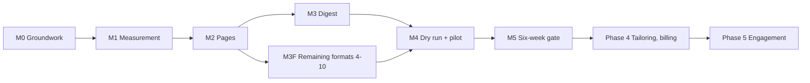

# Sheetfolio: Implementation Roadmap and Task Breakdown

> Status: **DRAFT for approval**, 11 Oct 2026
> Authority: all earlier documents. Task IDs link to requirements (FR/NFR), acceptance criteria (AC-J*), screens (ui-ux-spec), decisions (ADR-*), risks (R-*) and tests (testing-qa-strategy).
> This is a **plan, not a schedule**: you chose no fixed date and relative sizes only. No code is written in this phase; the first implementation task is M0 after you approve the discovery set.

Labels: **CONFIRMED**, **ASSUMED**, **OPEN**, **PROPOSED**, **NEW**.

---

## 1. Decisions taken for this document

| Decision | Choice | Status |
| --- | --- | --- |
| Structure | Milestones with gates, each split into epics and tasks | CONFIRMED |
| Effort | Relative sizes **S / M / L / XL**, no hours or days; recalibrate after M1 | CONFIRMED |
| First step | **M0 groundwork**: repository cleanup (R-1), backend skeleton, database, migration of today's data, then measurement | CONFIRMED |
| Backend language | **TypeScript** (O-37 answered) | CONFIRMED |
| Calendar dates | None (no fixed date) | CONFIRMED |

Size guide (relative to each other, not to time): **S** = a small contained change; **M** = a few connected pieces; **L** = a feature with several parts and tests; **XL** = a large feature that should be split further when its milestone starts.

---

## 2. Roadmap at a glance

| Milestone | Maps to | Outcome | Gate to leave it |
| --- | --- | --- | --- |
| **M0 Groundwork** | Architecture, privacy prerequisites | Clean repositories, backend and database running, today's data migrated, existing page unchanged and online | G0 |
| **M1 Measurement** | Phase 1 | Tracked links and click recording working end to end; admin Digest tab shows numbers | G1 |
| **M2 Pages** | Phase 2 | Invited members set up, build a master, publish, make variants and application links, in formats 1 to 3 plus the generic layout | G2 |
| **M3 Digest** | Phase 3 | Admin curates and sends a digest; members tailor from it | G3 |
| **M3F Remaining formats** | Phase 2/3 parallel | Formats 4 to 10 released one by one as they pass tests | each format passes its test |
| **M4 Dry run and pilot** | Testing doc §11 | Delivery, time zones and the Tailor flow proven with real inboxes and 2 to 3 members | G4 |
| **M5 Six-week gate** | MVP exit | Six weekly digests and the numbers read against the gate | G5 decision |

**Critical path:** M0 → M1 → M2 → M3 → M4 → M5. M3F runs alongside M2/M3 and must not delay the first digest (O-17).

---

## 3. Gates (what must be true to move on)

| Gate | Conditions |
| --- | --- |
| **G0** | R-1 remediation verified; two repositories with pipelines; backend and database live in staging; contract skeleton and error shape in place; sign-in works through the backend; today's data migrated and rehearsed; existing user's page identical (format 1 snapshot); backup restore tested in staging |
| **G1** | FR-1.1 to 1.4, 1.7, 1.8 tests pass; PR-1 to PR-5 privacy tests pass; log audit started (R-2); admin Digest tab shows correct figures on fixtures |
| **G2** | AC-J1 to J3, J8 pass; formats 1 to 3 pass render, accessibility and NFR-1; generic layout works; invitation flow works; privacy notice live in draft wording |
| **G3** | AC-J5 to J7 pass; email domain authenticated; unsubscribe tested; idempotent dispatcher proven; source terms check enforced |
| **G4** | Dry run done; pilot of 2 to 3 members completed; no critical or high defects; specialist privacy review complete; platform log audit complete; terms and report channel live |
| **G5** | Six digests sent; click rate and tailor rate read against 15% and 10% starting targets; decision recorded |

Any gate can fail; the fix goes back into that milestone.

---

## 4. M0: Groundwork

Goal: a safe, tested base before any new feature. The first real user's page stays online throughout (migration is reversible until cut-over).

### Epic 0.1: Privacy and repository clean-up (R-1)
| ID | Task | Size | Links | Done when |
| --- | --- | --- | --- | --- |
| T-0.1.1 | Locate every place the real person's details appear (files, history, PRs, forks); list findings without copying them | M | R-1, doc 11 §9 | Findings list exists |
| T-0.1.2 | Agree with the real user what must be removed | S | R-1 | Decision recorded |
| T-0.1.3 | Replace seed, test and doc data with fictional data | M | R-1 | Search finds no real details in files |
| T-0.1.4 | Rewrite history (**only with your explicit go-ahead**) and rotate any exposed secrets | L | R-1 | Second search clean; secrets rotated |
| T-0.1.5 | Add repository rules: fictional-only data, secret scanning | S | Doc 14 | Scanner runs in the pipeline |

### Epic 0.2: Repositories and delivery pipeline
| ID | Task | Size | Links | Done when |
| --- | --- | --- | --- | --- |
| T-0.2.1 | Create the backend repository (TypeScript) with conventions from document 14 | M | ADR-11 | Builds, lints, tests run |
| T-0.2.2 | Trim the frontend to rendering only, behind a stable data-access layer ready to call the backend | L | ADR-11 | Frontend no longer touches the datastore directly |
| T-0.2.3 | Pipelines for both repositories: lint, types, unit tests, secret scan, dependency alerts | M | Testing §7 | Green on a sample change |
| T-0.2.4 | Environments: local, preview, staging, production for both | M | ADR-7 | Each deploys; production only from the main branch |
| T-0.2.5 | Read the bundled framework documentation and record version-specific notes | S | Repository rule | Notes in document 14 |
| T-0.2.6 | Pin all dependencies to exact versions; list pre-release libraries with owners | S | ADR-10 | List published |

### Epic 0.3: Backend foundation
| ID | Task | Size | Links | Done when |
| --- | --- | --- | --- | --- |
| T-0.3.1 | Choose the managed SQL product and region (O-32) with backups | S | ADR-1, O-32 | Decision recorded |
| T-0.3.2 | Database schema for members, categories, masters, sections, variants, links (initial) | L | Data model §3 | Created through reviewed migrations |
| T-0.3.3 | Contract skeleton: one error shape, stable codes, request references, idempotency convention | M | API §2 | Contract tests run in both repositories |
| T-0.3.4 | Ownership check mechanism applied to every member endpoint | M | NFR-7 | Generated cross-member test passes |
| T-0.3.5 | Rate limiting service (Redis) and bot-rule configuration store | M | API §2.5 | Limits enforced in tests |
| T-0.3.6 | Health check, request references and failure-event log with no personal data | S | NFR-11 | Visible in staging |

### Epic 0.4: Identity
| ID | Task | Size | Links | Done when |
| --- | --- | --- | --- | --- |
| T-0.4.1 | Decide sign-in implementation under the split (O-39) | S | ADR-2, ADR-11 | Decision recorded |
| T-0.4.2 | Backend-owned sessions; magic-link sign-in (single use, hashed, short life) | L | ADR-2 | AC for sign-in pass |
| T-0.4.3 | Invitation model and neutral responses for unknown emails | M | AC-J1, M1 | Uninvited email cannot create an account |
| T-0.4.4 | Admin role, shorter admin sessions, admin action log | M | A8, R-8 | Tests pass |
| T-0.4.5 | Google sign-in (verified email only, same account) | M | ADR-2 | Can follow M2; start Google verification early (O-28) |

### Epic 0.5: Migration of today's data
| ID | Task | Size | Links | Done when |
| --- | --- | --- | --- | --- |
| T-0.5.1 | Inventory today's keys and map them to the model (data model §9) | M | Migration | Mapping approved |
| T-0.5.2 | Express the engineering page as the first format definition | L | ADR-3 | Output identical (visual snapshot) |
| T-0.5.3 | Migration script: repeatable, reversible, rehearsed on an anonymised copy | L | R-6 | Rehearsal passes twice |
| T-0.5.4 | Cut-over plan with the real user; backup first; rollback steps | M | R-14 | Cut-over done with no downtime beyond the plan |
| T-0.5.5 | Restore test of the database backup in staging | S | NFR-12 | Restore succeeds |

**G0** after all of the above.

---

## 5. M1: Measurement (phase 1)

Goal: prove the plumbing before building the loop.

| ID | Task | Size | Links | Done when |
| --- | --- | --- | --- | --- |
| T-1.1 | Application link create, list, rename, retire in the backend | M | FR-1.2, BR-3 | Tests §4.1 |
| T-1.2 | Shared page endpoint and frontend route; unavailable pages for every dead end | M | FR-1.2, V1, V5 | AC-J4 pass |
| T-1.3 | Job redirect endpoint: stored destinations only, never from the URL | M | FR-1.1, ADR-4 | Open-redirect test passes |
| T-1.4 | Edge forwarding of `/s` and `/j` from the frontend host to the backend | M | ADR-11 | Addresses unchanged; delay measured |
| T-1.5 | Click recording after the response, with retry buffer and fail-safe | L | FR-1.8, ADR-4 | Recording-outage test passes |
| T-1.6 | Click fields and the "never stored" rules (no IP, no raw user agent, no cookie) | M | PR-1 to PR-3, BR-5 | Privacy tests pass |
| T-1.7 | Bot rules: user-agent list and 2-second send window; configurable | M | FR-1.4 | Preview fetches not counted |
| T-1.8 | Member numbers: views per page, variant, link; small-count suppression | M | FR-1.7, M10, O-35 | Own data only |
| T-1.9 | Admin Digest tab: sent, clicked, click rate, variants created, tailor rate, top 10 jobs, gate view | L | FR-1.6, A2 | Figures match fixtures |
| T-1.10 | Click summariser (12 months) and bot-click cleanup | M | FR-1.9 | Clock-driven tests pass |
| T-1.11 | Platform log audit started: list layers that see requests and their retention | M | R-2, §3.2 | Audit table drafted |
| T-1.12 | Privacy notice page (draft wording) and link from public pages | S | V4, PR-6 | Visible on every public page |
| T-1.13 | Performance baseline for redirect and pages | S | NFR-1, NFR-2 | Budget set (O-61) |

**G1** after all.

---

## 6. M2: Pages (phase 2)

Goal: a member can set up, publish and share in formats 1 to 3.

### Epic 2.1: Section and format library
| ID | Task | Size | Links | Done when |
| --- | --- | --- | --- | --- |
| T-2.1.1 | Shared section types, validation, renderers and editors | XL | ADR-3, UI §6.1 | Section tests pass |
| T-2.1.2 | Format definition mechanism (versioned, in the codebase) | L | ADR-3 | Format 1 uses it unchanged |
| T-2.1.3 | Format 2 Technology: project showcase | M | UI §6.2 | Render, accessibility, NFR-1 tests pass |
| T-2.1.4 | Format 3 Business: achievements summary | M | UI §6.2 | Same |
| T-2.1.5 | Generic fallback layout | S | B6 | Used for categories without a format |
| T-2.1.6 | Sample content (fictional) for every format | M | Testing §6 | Used by tests and previews |

### Epic 2.2: Onboarding (J1)
| ID | Task | Size | Links | Done when |
| --- | --- | --- | --- | --- |
| T-2.2.1 | Welcome and setup: category, tags, time zone (detect then confirm), slug | L | M3, AC-J1 | Resume after refresh |
| T-2.2.2 | Tag vocabulary and limits (O-4) | S | FR-2.2 | Decision implemented |
| T-2.2.3 | Profession-to-category helper (O-3) | S | FR-2.1 | Picks the closest category |
| T-2.2.4 | Admin invitations and member list | M | A7 | Invite, resend, revoke |
| T-2.2.5 | Health member guidance at setup | S | F2 | Shown before continuing |

### Epic 2.3: Master and publishing (J2)
| ID | Task | Size | Links | Done when |
| --- | --- | --- | --- | --- |
| T-2.3.1 | Master editor with autosave, conflict handling, preview | L | M5 | AC-J2 pass |
| T-2.3.2 | File upload: validation after storage, re-encoding, metadata stripping, size limits | L | M5, NFR-7, O-12, O-52 | Upload security tests pass |
| T-2.3.3 | Publish review with problem list and reminders | M | M9, FR-2.7 | Unpublished drafts not public |
| T-2.3.4 | Public cache refresh on publish, suspend, restore | M | O-40 | Within target window |

### Epic 2.4: Variants and links (J3, J8)
| ID | Task | Size | Links | Done when |
| --- | --- | --- | --- | --- |
| T-2.4.1 | Variant create, list, delete with soft delete and restore | M | FR-2.5 | Tests §4.3 |
| T-2.4.2 | Follow/freeze per section with confirmation rules | L | BR-10, FR-2.6 | Unit and integration tests pass |
| T-2.4.3 | Variant editor with job context bar | L | M7 | AC-J3 pass |
| T-2.4.4 | Publish snapshot (O-34) | M | O-34 | Published variant unchanged by later master edits |
| T-2.4.5 | Application links panel | M | M8 | Copy, label, retire |
| T-2.4.6 | Master change panel (per-section follow choice) | M | J8 | AC-J8 pass |
| T-2.4.7 | Delete-blocked and move-links flow | S | O-18 | Rule enforced |

### Epic 2.5: Existing features on the new base
| ID | Task | Size | Links | Done when |
| --- | --- | --- | --- | --- |
| T-2.5.1 | Contact form and leads inbox through the backend | M | V3, M12 | Same behaviour |
| T-2.5.2 | CV PDF through the backend | M | M13 | Same output for format 1 |
| T-2.5.3 | Platform admin: suspension through the backend | M | A8, J9 | AC-J9 pass |

### Epic 2.6: Safety content
| ID | Task | Size | Links | Done when |
| --- | --- | --- | --- | --- |
| T-2.6.1 | Terms of use and a report channel (footer contact) | S | O-46 | Live |
| T-2.6.2 | Confidentiality reminders for categories 5, 7, 8 | S | UI §6.2 | Shown at entry and publish |

**G2** after all.

---

## 7. M3: Digest (phase 3)

| ID | Task | Size | Links | Done when |
| --- | --- | --- | --- | --- |
| T-3.1 | Job and source models; terms-checked recording | M | FR-3.7 | Unchecked source blocked |
| T-3.2 | Job intake: manual form | M | A3, J5 | Validation rules |
| T-3.3 | Paste and CSV import with preview, duplicates, idempotency | L | A3, API §6.2 | Tests pass |
| T-3.4 | Tagging screen and required tags | M | FR-3.1, A4 | Required tags enforced |
| T-3.5 | Matching engine (tag overlap, ranking, "why it matched") | L | FR-3.2, C1, C3 | Unit tests pass |
| T-3.6 | Digest build screen: categories included (max 3), adjustments | L | FR-3.6, A5 | Override requires confirmation |
| T-3.7 | Email interface, sending domain authentication, separate digest stream | L | ADR-6 | Test mailboxes receive |
| T-3.8 | Digest email template: job cards, View job, Tailor my page, unsubscribe | L | M14, FR-3.4 | Renders on phone, images off |
| T-3.9 | Dispatcher every 15 minutes, queue, idempotency, retries | L | ADR-5, FR-3.3 | Run-twice test passes |
| T-3.10 | Email events (bounce, complaint, unsubscribe) with signature checks | M | API §6.1 | Forged events rejected |
| T-3.11 | Unsubscribe and preferences page | M | M15 | One-click works |
| T-3.12 | Tailor from digest: sign-in then editor with job preserved; existing-variant prompt | L | J6, M7 | AC-J6 pass |
| T-3.13 | Digest preview and confirmed send | M | A6 | Deliberate send only |
| T-3.14 | Failures screen (failed sends and recordings) | S | A9, NFR-11 | Visible |
| T-3.15 | Hosting limit checks: scheduled jobs and email quotas | S | O-30, O-31 | Confirmed to fit |

**G3** after all.

---

## 8. M3F: Remaining formats (parallel)

Each format is released when it passes its render, accessibility and NFR-1 tests. Order follows the **confirmed build order** and the effort hypothesis.

| Order | Format | Size (relative) | Notes |
| --- | --- | --- | --- |
| 1 | 4 Creative: case-study gallery | L | First image-heavy format; sets image rules |
| 2 | 5 Legal: brief | M | Confidentiality reminders |
| 3 | 8 Education: teaching portfolio | M | Materials section |
| 4 | 7 Health: practice profile | M | No-patient-information guidance |
| 5 | 9 Media: clippings board | M | Link-rot handling |
| 6 | 6 Hospitality: menu | L | Photo-heavy |
| 7 | 10 Trades: job-card work log | L | Low-bandwidth, small images |

If a format is late when the first digest is ready, its members use the generic layout (O-17).

---

## 9. M4: Dry run and pilot

| ID | Task | Size | Links | Done when |
| --- | --- | --- | --- | --- |
| T-4.1 | Dry run: test mailboxes, three time zones, spam check, double-run check | M | Testing §11.1 | Findings fixed |
| T-4.2 | Specialist privacy review of notice, terms and processing (O-49) | M | Doc 11 | Written sign-off |
| T-4.3 | Platform log audit completed; configure shortest retention | M | R-2 | Notice is accurate |
| T-4.4 | Admin extra verification enabled (O-51) | M | R-8 | Tested |
| T-4.5 | Breach runbook and backup contact (O-55) | S | R-15 | Documented |
| T-4.6 | Pilot with 2 to 3 invited members for at least one cycle | L | Testing §11.2 | Findings list |
| T-4.7 | Fix critical and high findings | M-L | Testing §10 | None open |
| T-4.8 | Decide the minimum member count to read the gate (O-16) | S | R-13 | Number recorded |

**G4** after all.

---

## 10. M5: Six-week gate

| Item | Action |
| --- | --- |
| Weekly routine | Collect, tag, match, send Tuesday, review Friday (about 2 hours for 3 categories, hypothesis) |
| Weekly record | Click rate, jobs per clicker, variants created, tailor rate, bounce and complaint rates, recording loss |
| Source review | Drop sources with no clicks for 3 weeks |
| End of week 6 | Read against 15% click rate and 10% tailor rate (starting targets); record the decision; plan phases 4 and 5 or fix matching and sources first |

---

## 11. Later phases (outline only)

| Phase | Epics (no sizing yet) |
| --- | --- |
| 4 | Paste-a-job-ad and AI draft; plans, trial and read-only lapse; Paystack (verify O-7 first); re-run the security assessment (R-20) |
| 5 | Repeat-visit alert (needs a new privacy review, O-19); who-checked-me detail; site diary |
| After gate | Recruiter plan; verification; job scraper; per-country pricing and sales-tax provider |

---

## 12. Dependencies and sequencing rules

1. **R-1 before invitations;** no member is invited until G4.
2. **M0 before any feature,** because the split and SQL move touch everything.
3. **Contract first:** a contract change updates the API specification, then the backend, then the frontend (ADR-11).
4. **Format 1 snapshot** must stay green on every change to the section library.
5. **Google verification (O-28)** starts at M0 because of lead time; magic link alone is enough for M2 to M5.
6. **Hosting limits (O-30, O-31)** are checked before M3 starts, not at the end.
7. **Specialist review (T-4.2)** is booked early; it is the longest waiting item.
8. **No phase 4 work** before G5.

---

## 13. Risks to the plan

| Risk | Impact | Mitigation |
| --- | --- | --- |
| M0 is bigger than it looks (split, SQL, migration, sign-in redesign) | The first feature slips; motivation drops | Treat M0 as its own milestone with its own gate; keep each task small; consider merging to one repository if progress stalls (ADR-11 revisit) |
| Image-heavy formats hit NFR-1 late | Rework | Test the first sample content early (M3F order) |
| Specialist review takes weeks | Delays invitations | Book during M1 |
| Too few members for the gate | Cannot decide | Decide the minimum at T-4.8 and invite accordingly |
| Pre-release libraries change | Breakage | Exact pins; monthly check |
| Solo builder unavailable | Everything stops | Documentation; backup contact (O-55) |
| Scope creep from "every profession" | Never finish | Ten categories fixed; changes go through the PRD |

---

## 14. Estimating and calibration (CONFIRMED approach)

- Sizes are relative. After M1, count tasks completed per working week to get a pace and convert sizes into rough time for M2 and M3 (O-67).
- Each milestone starts with a short planning pass that splits any XL task further.
- Each milestone ends with a short review: what took longer than expected and why.

---

## 15. Open questions added by this document

| ID | Question | Proposal |
| --- | --- | --- |
| O-67 | Convert sizes to time after M1? | PROPOSED: yes, using measured pace |
| O-64 | Order of M2 and M1 if the first member needs a page published earlier than measurement | PROPOSED: keep order; the first real user is already live on the existing page |
| O-65 | Who is the real user to consult for T-0.1.2, and how are they contacted? | Your decision |
| O-66 | Is Google sign-in part of G2 or deferred until verified? | PROPOSED: deferred; not a gate |
| O-37 | Backend language | **Answered:** TypeScript |

---

## 16. Approval

- [ ] Milestones M0 to M5 and the gates G0 to G5
- [ ] Task lists and relative sizes (§4 to §9)
- [ ] Sequencing rules (§12)
- [ ] Later phases left as outlines (§11)
- [ ] Open questions O-64 to O-67 acknowledged
- [ ] Approved to start document 14 (AI coding instructions and repository conventions)
