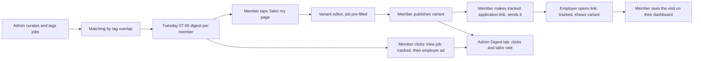

# Sheetfolio: User Journeys, Workflows and Acceptance Criteria

> Status: **DRAFT for approval**, 11 Oct 2026
> Scope: the **MVP** (phases 1 to 3, `docs/mvp-scope.md`). Later journeys are outlined in §10 without acceptance criteria.
> Authority: `docs/prd-v2.md`, `docs/requirements.md`. Requirement IDs link to them.

Labels: **CONFIRMED**, **ASSUMED**, **OPEN**, **PROPOSED**. Acceptance criteria use *Given / When / Then* and are written so each can be tested.

Decisions made for these journeys (CONFIRMED, 11 Oct 2026):
- Tapping **Tailor my page for this** while signed out sends a magic-link sign-in, then continues to the editor with the job still pre-filled.
- The admin adds jobs by manual form **and** by pasting a list or uploading a CSV, then tags them.
- A member's time zone is detected from the browser at sign-up and confirmed by the member.

---

## 1. The core loop

The north-star step is **E to G**: a clicker who creates a variant within 7 days.

---

## 2. Journey J1: Invited member joins

**Actors:** invited member, system. **Phase:** 2. **Requirements:** FR-2.1, 2.2, O-14.

| Step | Member does | System responds |
| --- | --- | --- |
| 1 | Receives an invite and opens the link | Shows a sign-in screen |
| 2 | Enters their email | Sends a magic link |
| 3 | Opens the magic link | Signs the member in |
| 4 | Enters name and profession | Maps the profession to a category and shows it for confirmation |
| 5 | Confirms or changes the category | Stores the category |
| 6 | Chooses matching tags | Stores the tags |
| 7 | Confirms the time zone | Pre-fills it from the browser; stores the confirmed value |
| 8 | Claims a page address (slug) | Checks it is unique, valid and not reserved |
| 9 | Lands on an empty master in the category's format | Shows what to fill in first |

**Alternative paths and errors**
- Magic link expired or reused: a clear message and an easy way to request another.
- Profession not recognised: the member picks a category from the list (O-3 defines how).
- Slug taken or reserved: an inline message and suggestions (ASSUMED).
- Browser time zone unavailable: the member must pick one before continuing.
- Member already has an account: signs in and goes to the dashboard.

**Acceptance criteria**
- **AC-J1.1** *Given* an invited email, *when* the member completes sign-in, *then* they cannot reach the dashboard without a category, at least one tag and a confirmed time zone.
- **AC-J1.2** *Given* a slug already claimed, *when* a second member tries it, *then* the claim is refused and the first member's page is unaffected, even if both submit at the same moment.
- **AC-J1.3** *Given* a reused or expired magic link, *when* it is opened, *then* no session is created.
- **AC-J1.4** *Given* a browser that reports a time zone, *when* the member reaches step 7, *then* it is pre-filled and editable.

---

## 3. Journey J2: Build the master and publish

**Actors:** member. **Phase:** 2. **Requirements:** FR-2.3, 2.4, 2.7.

| Step | Member does | System responds |
| --- | --- | --- |
| 1 | Fills the master in their category's native format | Validates each field; shows a plain-language message on error |
| 2 | Adds photos and documents | Validates type and size (limits O-12); shows progress |
| 3 | Previews | Shows the page as the public will see it, marked as a preview |
| 4 | Publishes | Checks required fields; if valid, makes it public; if not, lists each problem |

**Alternative paths and errors**
- Required field missing at publish: publish is refused and each missing field is named.
- Upload fails or is too large: the field shows an error and the rest of the form is kept.
- Member closes the browser mid-edit: the draft saved so far is kept (ASSUMED: existing draft-save behaviour).
- Category format not ready yet (formats 4 to 10 early in the MVP): the member sees the generic layout and a note that a native format is coming.

**Acceptance criteria**
- **AC-J2.1** *Given* an unpublished draft, *when* anyone opens the public address, *then* they get a not-found page.
- **AC-J2.2** *Given* missing required fields, *when* the member publishes, *then* nothing becomes public and every missing field is listed.
- **AC-J2.3** *Given* a published page, *when* the member edits the master without publishing, *then* the public page is unchanged.
- **AC-J2.4** *Given* any of the 10 formats, *when* its public page is measured on the test phone profile, *then* it meets NFR-1.

---

## 4. Journey J3: Create a variant and an application link

**Actors:** member. **Phase:** 2. **Requirements:** FR-2.5, 2.6, 1.2.

| Step | Member does | System responds |
| --- | --- | --- |
| 1 | Chooses **New variant** (or arrives from the digest, J6) | Opens the variant editor with the master's content |
| 2 | Names the variant for the job | Stores the name |
| 3 | For each section chooses **follow master** or **freeze** | Applies the choice (default OPEN, O-5) |
| 4 | Edits sections to fit the job | Validates as in J2 |
| 5 | Publishes the variant | Makes it viewable through application links only (ASSUMED, see O-18) |
| 6 | Creates an application link with a label, e.g. "Dangote – Site Engineer" | Generates `/s/{code}` and shows it to copy |
| 7 | Sends the link to the employer | |

**Alternative paths and errors**
- Two application links with the same label: allowed; the member is warned that the dashboard will show both (ASSUMED).
- Label empty: not allowed.
- Variant deleted while it has application links: **OPEN (O-18).** PROPOSED: block deletion and tell the member which links exist, or let them move links to another variant.
- Member loses their place: the editor saves drafts.

**Acceptance criteria**
- **AC-J3.1** *Given* a master and a variant with a section set to follow, *when* the master section changes, *then* the variant shows the change.
- **AC-J3.2** *Given* a section set to freeze, *when* the master changes, *then* the variant is unchanged.
- **AC-J3.3** *Given* one variant, *when* the member creates three application links with different labels, *then* each resolves to the variant and records visits under its own label.
- **AC-J3.4** *Given* an application link, *when* its code is guessed or mistyped, *then* a not-found page appears and nothing is recorded under a member.
- **AC-J3.5** *Given* an empty label, *when* the member tries to create the link, *then* it is refused.

---

## 5. Journey J4: A visitor opens an application link

**Actors:** employer or recruiter (visitor), robots. **Phase:** 1. **Requirements:** FR-1.2, 1.3, 1.4, 1.8, BR-5.

| Step | Visitor or system | Result |
| --- | --- | --- |
| 1 | Visitor taps the link in an email, message or LinkedIn | Request arrives at `/s/{code}` |
| 2 | System checks the request against the robot rules | Robots are shown or redirected normally but **not counted** |
| 3 | System resolves the code | Finds the variant and member |
| 4 | System records the visit (time, link, member, country, device, first or repeat) | No IP stored; failure to record does not stop the page |
| 5 | System shows the variant | The visitor reads the page |
| 6 | Visitor may contact the member through the page | As the existing contact options |

**Alternative paths and errors**
- Unknown code: not-found page, no record.
- Recording store unavailable: the page still shows (FR-1.8); the failure is logged.
- Messaging app or email scanner fetches the link to build a preview: no visit is counted.
- Same visitor returns: counted as a repeat visit (how "same visitor" is decided without identity is OPEN, O-19).
- Country cannot be derived: stored as unknown.
- Member's page is suspended: not-found page (existing behaviour).

**Acceptance criteria**
- **AC-J4.1** *Given* a valid link, *when* a person opens it, *then* the variant shows and exactly one visit is recorded with no IP.
- **AC-J4.2** *Given* a request from a known preview or scanner agent, *when* it fetches the link, *then* the page loads and no visit is counted.
- **AC-J4.3** *Given* a request within 2 seconds of the send time of a digest, *when* it hits a digest link, *then* it is not counted.
- **AC-J4.4** *Given* the recording store is down, *when* a person opens a valid link, *then* the page still shows.
- **AC-J4.5** *Given* a person opening the same link a second time, *when* it is counted, *then* it is marked repeat (subject to O-19).
- **AC-J4.6** *Given* a visit, *when* the member views their dashboard, *then* it shows the link's label and country, and never a name, email or IP.

---

## 6. Journey J5: Admin curates and sends the weekly digest

**Actors:** admin (Olareign). **Phase:** 3. **Requirements:** FR-3.1 to 3.7.

| Day | Admin does | System responds |
| --- | --- | --- |
| Monday | Adds jobs by manual form or by pasting a list or uploading a CSV | Imports rows, flags any that are missing required fields or older than 14 days |
| Monday | Tags each job (role, seniority, skills, location, remote or on-site, closing date) | Validates tags |
| Monday | Records the source and that its terms were checked | Blocks jobs from sources not marked as checked |
| Monday | Runs matching | Builds each member's 5 to 8 jobs, best match first, with a reason ("matches: HSE, site supervision") |
| Monday or Tuesday | Reviews a digest preview | Shows a sample digest per category (should-have) |
| Tuesday 07:00 | Digest sends | Sends in each member's time zone; every job link is a tracked link |
| Friday | Reads the Digest tab (J7) | |

**Alternative paths and errors**
- Import with bad rows: good rows are imported; bad rows are listed with reasons.
- Member with fewer than 5 matches: gets fewer, no filler.
- Member with no matches: no digest that week; the admin sees them in a "no matches" list.
- A fourth category is added in the first 6 weeks: blocked unless the admin overrides explicitly (BR-9).
- Job closing date passed before send: removed automatically.
- Send fails for some members: the failures are listed for the admin; a retry sends only to those not yet sent.
- Duplicate send (double click, retry): a member never receives the same digest twice.
- Member's time zone changes after matching: the send uses the time zone at send time (ASSUMED).

**Acceptance criteria**
- **AC-J5.1** *Given* a job older than 14 days, *when* it is imported, *then* it is flagged and cannot be placed in a digest.
- **AC-J5.2** *Given* a job from a source not marked as checked, *when* matching runs, *then* it is excluded.
- **AC-J5.3** *Given* a member with overlapping tags, *when* matching runs, *then* they receive between 5 and 8 jobs unless fewer match, ordered best first, each with a reason.
- **AC-J5.4** *Given* a digest, *when* it is sent, *then* every job button is a tracked link and every send has a recorded digest id.
- **AC-J5.5** *Given* a send retry, *when* some members already received the digest, *then* they do not receive it again.
- **AC-J5.6** *Given* members in different time zones, *when* Tuesday arrives, *then* each gets the digest at 07:00 their time (within a stated tolerance, OPEN).
- **AC-J5.7** *Given* 3 categories in the first 6 weeks, *when* the admin adds a fourth, *then* it is blocked without an explicit override.

---

## 7. Journey J6: Member opens the digest and tailors a page

**Actors:** member. **Phase:** 3. **Requirements:** FR-3.4, 2.5, 1.1.

| Step | Member does | System responds |
| --- | --- | --- |
| 1 | Opens the digest email | Shows 5 to 8 job cards |
| 2a | Taps **View job** | Records a click, then forwards to the employer's ad |
| 2b | Taps **Tailor my page for this** | Opens the sign-in or the editor (see below) |
| 3 | If signed out: gets a magic link by email | Magic link sent; after sign-in continues to the editor |
| 4 | Lands in the variant editor | Job title, company and requirements pre-filled; a new variant started |
| 5 | Edits and publishes the variant (J3) | Counts toward the tailor rate if within 7 days of the click |

**Alternative paths and errors**
- Job link dead or employer ad removed: the member lands on the employer's error; Sheetfolio recorded the click anyway.
- Job removed from Sheetfolio after sending: the click still forwards if the destination is known; otherwise a friendly page.
- Magic link not received: the member can request another; the job context is kept (ASSUMED).
- Member leaves the editor before publishing: a draft variant exists; the tailor rate counts a variant when it is created (definition to confirm, O-20).
- Member taps tailor for the same job twice: opens the existing variant instead of creating a second (ASSUMED).

**Acceptance criteria**
- **AC-J6.1** *Given* a digest job, *when* the member taps View job, *then* exactly one click is recorded and the browser lands on the employer's ad.
- **AC-J6.2** *Given* a signed-out member, *when* they tap Tailor my page and complete the magic link, *then* they arrive in the variant editor for that same job.
- **AC-J6.3** *Given* a signed-in member, *when* they tap Tailor my page, *then* the editor opens with the job pre-filled and no extra sign-in.
- **AC-J6.4** *Given* a member who tapped Tailor for the same job twice, *when* the second tap arrives, *then* the existing variant opens.
- **AC-J6.5** *Given* a clicker who creates a variant within 7 days, *when* the Digest tab is read, *then* the tailor rate includes them.

---

## 8. Journey J7: Admin reads the numbers and the gate

**Actors:** admin. **Phase:** 1 and 3. **Requirements:** FR-1.6.

| Step | Admin does | System responds |
| --- | --- | --- |
| 1 | Opens the Digest tab | One row per week: sent, clicked, click rate, variants created, tailor rate |
| 2 | Reads the 10 most-clicked jobs | Shows jobs with clicks |
| 3 | Notes tags and sources that earned clicks, and sources with none for 3 weeks | Highlights them |
| 4 | Compares against the starting targets | 15% click rate, 2 jobs per clicker, 10% tailor rate, 30% application open rate |

**Acceptance criteria**
- **AC-J7.1** *Given* a test week with known clicks, *when* the tab is read, *then* every figure equals a hand count.
- **AC-J7.2** *Given* robot clicks, *when* the tab is read, *then* they are excluded.
- **AC-J7.3** *Given* a non-admin, *when* they open the tab, *then* access is refused.
- **AC-J7.4** *Given* 6 weeks of data, *when* the admin checks the gate, *then* click rate, jobs per clicker, tailor rate and application open rate are all visible.

---

## 9. Journey J8 and J9: Master changes, suspension and safety

### J8: Member edits the master after variants exist
| Step | Result |
| --- | --- |
| Member changes a section of the master | The system asks nothing at edit time; the per-section follow or freeze settings decide each variant's content |
| Member publishes the master | Followed sections update on variants; frozen sections stay |

**Edge cases**
- A new section is added to the master: its default on existing variants is OPEN (O-5).
- A section removed from the master that a variant follows: the variant shows the last content with a notice, or removes it (OPEN, O-5).
- Two edits at once from two devices: the later save does not silently overwrite the earlier (ASSUMED; method decided in architecture).

**Acceptance:** AC-J3.1 and AC-J3.2 apply.

### J9: Admin suspends a page
| Step | Result |
| --- | --- |
| Admin suspends a member's page | The public page and its application links return not-found; the member can still sign in |
| Admin lifts the suspension | Links work again |

**Acceptance**
- **AC-J9.1** *Given* a suspended member, *when* anyone opens their application link, *then* a not-found page appears and no visit is recorded.
- **AC-J9.2** *Given* a suspended member, *when* the digest is sent, *then* they are excluded (ASSUMED).

### Cross-cutting failure and edge scenarios
| Scenario | Expected behaviour |
| --- | --- |
| Email provider down at send time | Failures listed for retry; no member gets a duplicate |
| Click recorded twice by retry | Counted once (idempotent recording; ASSUMED) |
| Employer destination URL invalid | Click recorded; member sees a friendly error |
| Member uploads a patient photo or names a patient (Health) | Guidance shown at setup (F2); enforcement approach OPEN |
| Very long or malicious text in forms | Validated, limited and escaped |
| Concurrent slug claims | Exactly one succeeds (AC-J1.2) |

---

## 10. Later journeys (outlined, no acceptance criteria yet)

| Journey | Phase | Outline |
| --- | --- | --- |
| Trial and lapse | 4 | 14 days of Pro, a plan choice, read-only page with "Made with Sheetfolio" prompt, digest stops |
| Pay with Paystack | 4 | Choose a plan, pay, plan updates, failures keep the current state |
| AI tailoring | 4 | Paste a job ad, get a draft variant, review and edit before publishing |
| Repeat-visit alert | 5 | A second real visit to an application link notifies the member |
| Who checked me | 5 | Totals and countries for all plans; per-link detail on Pro |
| Site diary | 5 | One photo and one line a week, reminder, entries shown on the page |
| Recruiter search | After gate | Search members and contact them, after verification |

---

## 11. Open questions added by this document

| ID | Question |
| --- | --- |
| O-18 | What happens when a variant with application links is deleted? PROPOSED: block deletion and offer to move links. |
| O-19 | How is a "repeat" visit decided without identifying the visitor (for example a cookie, a short-lived hashed fingerprint, or per-link only)? Privacy review needed. |
| O-20 | Does the tailor rate count a variant when it is created or when it is published? PROPOSED: created, as the plan says "create a tailored variant". |
| O-21 | Tolerance for "07:00 member time" (for example within 15 minutes). |

---

## 12. Approval

- [ ] Journeys J1 to J9 match how you want the product to work
- [ ] Acceptance criteria are testable and correct
- [ ] Assumptions and open questions O-18 to O-21 acknowledged
- [ ] Approved to start document 7
